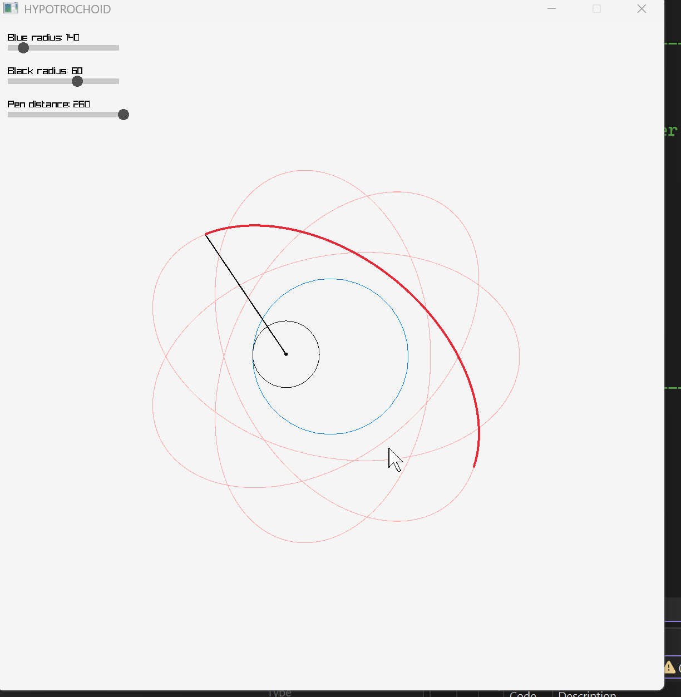

# Hypotrochoid Visualizer

An interactive spirograph built with **C++** and **[raylib](https://www.raylib.com/)**. Watch a small circle roll around the inside of a larger one while a pen attached to it traces out a hypotrochoid curve, and reshape the pattern in real time with sliders.

Created as my midterm project for 2D Games Programming.



## Features

- **Live animation** of the rolling circle, its arm, and the pen tip
- **Full curve preview** drawn as a faint red line, so you can see the final shape before the pen finishes tracing it
- **Glowing trail** that follows the pen tip in thick red
- **Three interactive sliders** that update the pattern instantly
- Smooth 60 FPS rendering

## How It Works

A hypotrochoid is the curve traced by a point attached to a circle rolling inside a larger fixed circle. Here:

- **Blue circle**: the fixed outer circle (radius `R`)
- **Black circle**: the rolling inner circle (radius `r`)
- **Pen distance** (`d`): how far the pen sits from the center of the black circle (it can sit outside the circle, which gives looping patterns)

The pen position at angle `t` is:

```
x = (R - r) * cos(t) + d * cos(((R - r) / r) * t)
y = (R - r) * sin(t) - d * sin(((R - r) / r) * t)
```

The black circle's center travels on a circle of radius `R - r`, while `(R - r) / r * t` gives how far the black circle has spun on its own axis. The faint red curve is made by sampling this formula over many values of `t` and connecting the points with short line segments.

## Controls

Click and drag any slider with the mouse. Values snap in increments of 10.

| Slider | Range | What it does |
| --- | --- | --- |
| Blue radius | 100 – 380 | Size of the outer circle |
| Black radius | 10 – 90 | Size of the rolling circle |
| Pen distance | 10 – 250 | Distance of the pen from the rolling circle's center |

Small changes to the ratio between the blue and black radii can completely change the pattern, so experiment!

## Getting Started

### Prerequisites

- A C++ compiler (g++, clang, or MSVC)
- [raylib](https://github.com/raysan5/raylib) installed (see the [raylib installation guide](https://github.com/raysan5/raylib#build-and-installation))

### Build and Run

**Linux / macOS (g++):**

```bash
g++ main.cpp -o hypotrochoid -lraylib -lm
./hypotrochoid
```

> On Linux you may also need `-lGL -lpthread -ldl -lrt -lX11`. On macOS, add `-framework OpenGL -framework Cocoa -framework IOKit`.

**Windows (Visual Studio):**

1. Create a new C++ project and link against raylib (e.g. via NuGet or a prebuilt release).
2. Add the source file to the project.
3. Build and run.

Replace `main.cpp` with the actual name of your source file.

## Project Structure

| Function | Description |
| --- | --- |
| `PenPosition()` | Calculates the pen tip position using the hypotrochoid formula |
| `Slider()` | Draws a slider, handles mouse input, and returns the updated value |
| `Hypotrochoid()` | Sets up the window and runs the main draw loop |
| `main()` | Entry point |

## Built With

- [C++](https://isocpp.org/)
- [raylib](https://www.raylib.com/) and `raymath`

## Author

Made by **YOUR NAME** for 2D Games Programming.
